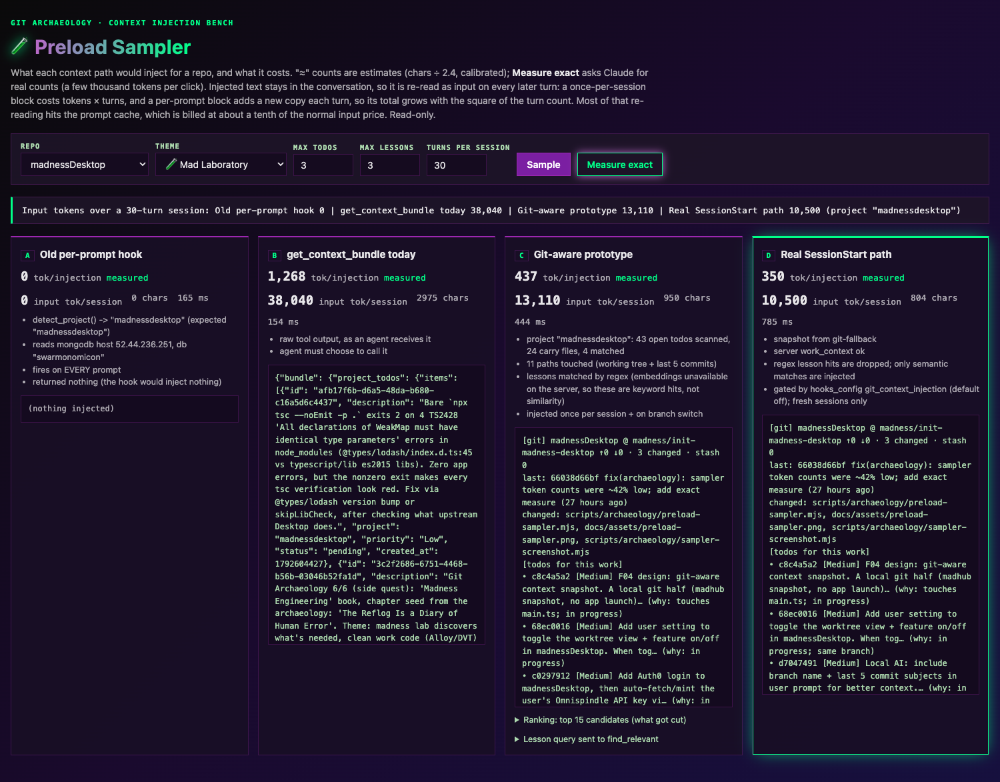

# Terminal, Local AI, and Claude Code

## Integrated terminal

A terminal panel at the bottom of the window, opened in the current
repository.

- **Toggle it:** **Ctrl+\`**, or **Repository → Toggle Integrated Terminal**.
- **Tabs:** **+** opens another shell; **claude ✦** opens a tab running
  `claude`. Each tab starts in the repository's folder.
- **From the exploded view:** right-click a loose file and choose **Open in
  Terminal (vim)** to open the panel with a new tab, named after the file,
  running `command vim` on it. `command` skips any `vim` alias or function in
  your dotfiles. The item is greyed out for a file whose name contains
  control characters, since the command is typed into the shell.
- **It keeps going:** each repository gets its own set of terminals, and they
  survive switching to another repository and back, or hiding the panel.
  Removing a repository from the app closes its terminals.

Settings live in **Settings → Advanced → Integrated terminal**: show the
terminal on startup, cursor blink, font size, and scrollback lines.

### Dotfiles panel

Next to the terminal, **Cmd+Option+\`** (or **Repository → Toggle Dotfiles
Panel**) opens an editor with a tab each for `~/.zshrc`, `~/.gitconfig`, your aliases
file (the first of `~/.aliases`, `~/.zsh_aliases`, or `~/.bash_aliases` that
exists), and the current repository's `.git/config`. Unsaved edits survive
switching tabs; a file that doesn't exist yet is created when you save.

## Local AI

Commit messages and diff explanations from a model running on your own
machine, through [LM Studio](https://lmstudio.ai) or
[Ollama](https://ollama.com). Off until you turn it on.

**Set it up** in **Settings → AI Services → Local AI**: enable it, pick LM
Studio or Ollama (the base URL defaults to `http://localhost:1234` or
`http://localhost:11434`), and choose a model — the list is read from the
server. You can also swap the system prompt for your own.

**Use it:**

- **Generate a commit message:** the robot button in the commit box, or just
  press **Commit** with an empty summary. The message streams in as the model
  writes it.
- **Explain a diff:** the **Explain changes** button in the diff header opens
  an explanation of the file you're looking at.

**What's sent:** the diff of the selected files, plus your branch name and
recent commit subjects (cleaned up first unless you turn **Sanitize git
context in prompts** off). It goes to the base URL's OpenAI-compatible
`/v1/chat/completions` endpoint. Plain `http://` to anything other than this
machine is refused unless you allow it — but an `https://` address on another
machine is accepted, so the base URL decides where your code goes.

The sanitizing and non-local settings are only shown when beta features are
enabled.

## Claude Code hooks

**Settings → Claude Code** installs the workshop's
[Claude Code](https://claude.com/claude-code) hooks for you:

1. It clones [`MadnessEngineering/crochetomancy`](https://github.com/MadnessEngineering/crochetomancy)
   into `~/.claude/hooks` (or `git pull --ff-only`s it if it's already there).
2. You pick a tier — **Minimal**, **Standard**, or **Full** — and it checks
   the tier's dependencies.
3. **Install** adds that tier's hook commands to `~/.claude/settings.json`.

It only ever appends to `settings.json`, and it records what it added, so
**Uninstall** removes exactly those entries and leaves your own hooks alone.

### Session colors

Every tier colors each Claude Code session's prompt bar by project, so a
screen of parallel sessions sorts itself at a glance. The project is the
git repository the session starts in (a submodule counts as its own
project), and each one keeps the same color every time.

- **Pick your own colors** in `~/.claude/session_colors.json`:
  `{"my-project": "cyan"}`. The choices are `red`, `blue`, `green`,
  `yellow`, `purple`, `orange`, `pink`, and `cyan`; projects you don't list
  get a color derived from their name.
- **`/color` still wins.** The hooks never overwrite a color you set yourself.
- **Turn it off** with `"session_color": false` in `~/.claude/hooks_config.json`.

Background sessions (`claude --bg`, forks) take their color right away. A
normal terminal session picks it up the next time you `/resume` it.

The hooks set the color by writing the same files `/color` does — Claude
Code has no official hook setting for it. A Claude Code update could stop it
working; if that happens, sessions simply keep the default color.

### Session-start work context

The hooks can open each new Claude Code session with a short note on what
you're in the middle of: the repo's git state, plus up to three open
Omnispindle todos that touch the files you're changing. Each todo says why
it was picked (`touches app-store.ts`, `in progress`, `same branch`), so the
agent can tell a real lead from noise.

It's **off by default**. Turn it on with `"git_context_injection": true` in
`~/.claude/hooks_config.json`. It runs on fresh sessions only, not on
`/resume`.

How it works:

- **Git state** comes from `madhub snapshot --json`, which reads the repo
  directly without opening the app. Installs older than that command fall
  back to plain `git`.
- **Todos** come from Omnispindle's `get_context_bundle` with the touched
  files, branch and recent commit subjects. The server ranks open todos by
  how many of those files they list in their own `files`.
- **Lessons** are only included when the server can match them by meaning.
  Right now it can only match by keyword, which proved to be noise, so no
  lessons are injected yet.
- Anything that fails (no repo, no network, an old server) just means no
  note. A session never fails to start because of it.

#### Preview it before turning it on

The preload sampler shows exactly what would be injected for any repo, next
to the other ways of feeding context, with token costs:

```sh
make sampler   # starts it (or reuses a running one) and opens http://127.0.0.1:4747
```



Panel **D** is the real session-start note. **Measure exact** asks Claude for
true token counts (it costs a few thousand tokens per click); otherwise the
counts are estimates. Injected text stays in the conversation and is
re-read on every later turn, so the per-session figures multiply by the
number of turns. For madnessDesktop the note measured about 350 tokens, or
roughly 10,500 input tokens over a 30-turn session, most of it served from
the prompt cache. The theme picker uses the same MadnessThemes palettes as
the app.

To re-shoot this screenshot, run `make sampler-shot` (add
`REPO=Omnispindle THEME=terminal` to pick another repo or palette). It starts
a temporary sampler if none is running.
